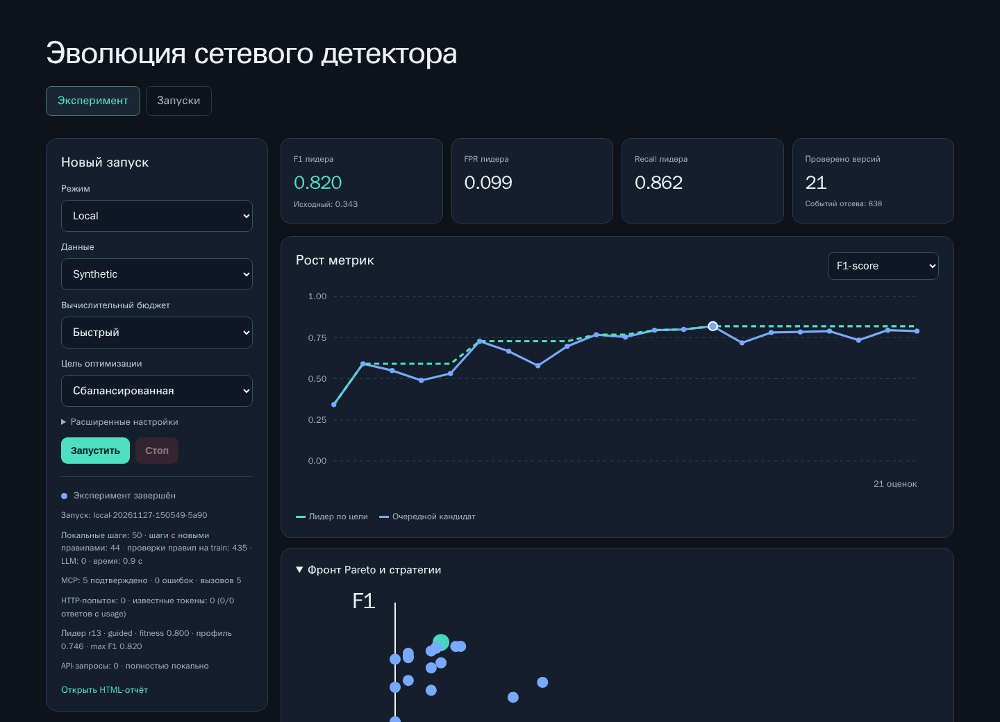

# Network Evolution Lab v1.0.0

A local-first evolutionary framework for interpretable network intrusion detection, with adaptive search, multi-objective optimization, MCP-based metric verification, and optional LLM assistance. It studies the trade-off between detection, false positives, and rule complexity on labeled network flows.

## Quick start with Docker Compose

```sh
docker compose up -d --build --wait
```

Open [the local panel](http://127.0.0.1:8080/), choose **Local** and **Synthetic**, and start a run. No API key or dataset download is needed. Nginx serves the panel, the worker runs CPU search, and the private metrics service verifies generation checkpoints over MCP Streamable HTTP. Hybrid shares the engine and can ask Groq for a bounded proposal after stagnation.



## Measured results

The fixed Hybrid run leader `r69` scored **F1 0.9437, FPR 0.0759** on internal validation. On all 82,332 rows of the official UNSW-NB15 test, it scored **F1 0.8785, FPR 0.1911, recall 0.9055, precision 0.8531**. The run made zero Groq requests. Validation over five seeds averaged F1 0.9224 and FPR 0.0985. The official test was previously examined during development; it is not a blind holdout. Results describe this dataset and protocol. [Evaluation protocol and reproduction](docs/evaluation.md)

## Run locally

Python 3.12 is recommended. For a CPU-only run:

```sh
python -m pip install -r requirements-local.txt
python -m search.local_evolution --dataset synthetic --budget quick --no-mcp
python app.py
```

Use `requirements-mcp.txt` for MCP or `requirements.txt` for MCP and Groq. Local uses zero LLM requests. Hybrid runs locally with the default budget of zero. A positive `--llm-budget` and `GROQ_API_KEY` enable bounded requests after stagnation. The Groq SDK does not retry behind the request counter.

ShinkaEvolve is an experimental CLI comparison. Install `requirements-shinka.txt` and use `python -m search.run_shinka --dataset synthetic --generations 2 --llm-budget 3 --output results/shinka-comparison` only when you intend to spend the configured Groq attempts. The live Groq integration for Shinka has yet to be verified. The panel offers Local and Hybrid.

## UNSW-NB15

```sh
python -m traffic_data.download_unsw
python -m search.local_evolution --dataset unsw --budget standard --no-mcp --output results/unsw-experiment
python -m evaluation.final_test --run results/unsw-experiment --reserve
python -m evaluation.final_test --run results/unsw-experiment
```

The search reads the official training file, stratifies by class and category, keeps identical feature vectors in one split, and records a sample fingerprint. It reserves part of the training file for a separate check. Obtain the CSVs separately and follow the dataset citation requirements. The project code is MIT-licensed. UNSW-NB15 has its own terms. [UNSW dataset and citation requirements](https://research.unsw.edu.au/projects/unsw-nb15-dataset) · [MIT license](LICENSE)

## Research and verification

```sh
python -m tools.benchmark --dataset unsw --modes local hybrid --seeds 42 43 44 45 46 --workers 2 --output results/comparison
python -m tools.audit_data --output results/data-quality.json
python -m ruff check .
python -m unittest discover -s tests
python -m tools.mcp_smoke
docker compose up -d --build --wait
python -m tools.docker_smoke
```

See the [algorithm and profiles](docs/algorithm.md), [research report](docs/research.md), [MCP tools](docs/mcp.md), [Compose](docs/docker.md), [release checklist](docs/release-checklist.md), [security model](SECURITY.md) and [Russian README](README.ru.md). The detector assumes precomputed flow features and an instrumentation pipeline that produces them consistently. See the research report for measured trade-offs and the limits of the available benchmark.
