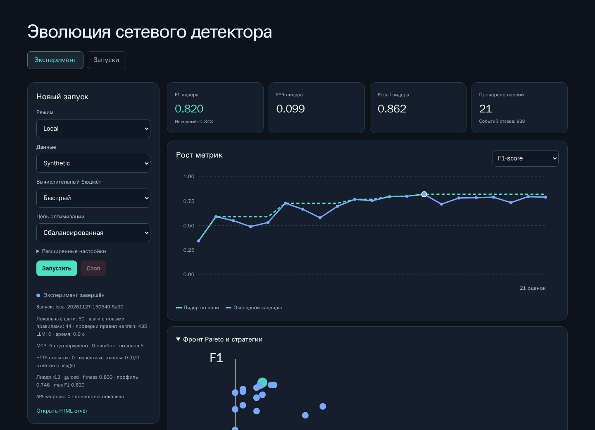

# Network Evolution Lab v1.0.0

Локальная исследовательская платформа для эволюции интерпретируемых правил обнаружения атак. Она позволяет исследовать компромисс между обнаружением, ложными срабатываниями и сложностью правил на размеченных сетевых потоках.

## Быстрый старт через Docker Compose

```sh
docker compose up -d --build --wait
```

Открой [локальную панель](http://127.0.0.1:8080/), выбери **Local** и **Synthetic**, затем запусти эксперимент. Для этого достаточно Compose. Nginx отдаёт панель, worker выполняет адаптивный поиск и Pareto-отбор на CPU, а закрытый сервис metrics сверяет оценки через MCP Streamable HTTP. Hybrid использует тот же движок и при заданном бюджете может обратиться к Groq после застоя.



## Результаты

Зафиксированный лидер Hybrid `r69` получил **F1 0,9437 и FPR 0,0759** на внутреннем validation. На всех 82 332 строках официального UNSW-NB15 test результат составил **F1 0,8785, FPR 0,1911, recall 0,9055, precision 0,8531**. За запуск выполнено ноль запросов Groq. На пяти seed средние показатели validation составили F1 0,9224 и FPR 0,0985. Официальный test ранее анализировался при разработке и не является слепой контрольной выборкой. [Протокол и результаты оценки](docs/evaluation.md)

## Запуск

```sh
python -m pip install -r requirements-local.txt
python -m search.local_evolution --dataset synthetic --budget quick --no-mcp
python app.py
```

Для MCP установи `requirements-mcp.txt`, для Groq — `requirements.txt`. Local работает без LLM. Hybrid с нулевым бюджетом использует тот же локальный поиск. Для запросов Groq нужен положительный `--llm-budget` и ключ `GROQ_API_KEY` в окружении или локальном `.env`. ShinkaEvolve доступен как опциональный CLI-эксперимент с `requirements-shinka.txt`. В панели доступны Local и Hybrid. Условия проверки Shinka описаны в исследовательском отчёте.

## UNSW-NB15 и сравнение

```sh
python -m traffic_data.download_unsw
python -m search.local_evolution --dataset unsw --budget standard --no-mcp --output results/unsw-experiment
python -m evaluation.final_test --run results/unsw-experiment --reserve
python -m evaluation.final_test --run results/unsw-experiment
python -m tools.benchmark --dataset unsw --modes local hybrid --seeds 42 43 44 45 46 --workers 2 --output results/comparison
```

Поиск открывает официальный train, стратифицирует по классу и категории и держит точные дубликаты признаков в одной части. Итоговая оценка запускается после фиксации правила. Внутренний резерв также оценивается отдельно. CSV получают отдельно по условиям UNSW. Код проекта распространяется по лицензии MIT. [Условия и цитирование UNSW](https://research.unsw.edu.au/projects/unsw-nb15-dataset) · [Лицензия MIT](LICENSE)

## Проверки

```sh
python -m ruff check .
python -m unittest discover -s tests
python -m tools.mcp_smoke
docker compose config --quiet
docker compose up -d --build --wait
python -m tools.docker_smoke
```

Панель Compose доступна на `http://127.0.0.1:8080`. [Алгоритм и профили](docs/algorithm.md), [исследовательский отчёт](docs/research.md), [Docker Compose](docs/docker.md), [MCP](docs/mcp.md), [безопасность](SECURITY.md), [чек-лист релиза](docs/release-checklist.md).
